# Admin Toolbox for Business Central OnPrem

The Admin Toolbox is an extension for Microsoft Dynamics 365 Business Central OnPrem. It provides administrators and consultants with tools for bulk data deletion, record editing, table backup and restore, audit logging and license administration.

The extension combines several community tools in one app and adds a backup system, an audit log and a dashboard around them. See [CHANGELOG.md](CHANGELOG.md) for the release history.

## Contents

1. [Features](#features)
2. [Important notice](#important-notice)
3. [Requirements](#requirements)
4. [Installation](#installation)
5. [Getting started](#getting-started)
6. [Dashboard](#dashboard)
7. [Setup](#setup)
8. [Record deletion](#record-deletion)
9. [Table Editor](#table-editor)
10. [Table backups](#table-backups)
11. [Audit log](#audit-log)
12. [Information tables](#information-tables)
13. [License management](#license-management)
14. [Publishing apps](#publishing-apps)
15. [Permissions and security](#permissions-and-security)
16. [Languages](#languages)
17. [Development and testing](#development-and-testing)
18. [Contributing](#contributing)
19. [Credits](#credits)
20. [License](#license)

## Features

| Area | Description | Origin |
|---|---|---|
| Record deletion | Delete the records of many tables at once, with suggestions for transactional tables | [Record Deletion Tool](https://navinsights.net/2020/04/02/record-deletion-tool/) by Waldemar Brakowski, based on the NAV tool by Olof Simren |
| Table relation check | Find records that refer to related records that do not exist | Record Deletion Tool |
| Table Editor | Modify, rename, create or delete records in any table | Yuri Mishin |
| Table backups | Create, export, import and restore table backups in JSON format | Waldemar Brakowski |
| Audit log | Log of all operations with field level change history | Waldemar Brakowski |
| Dashboard | Statistics about tables, backups and recent operations | Waldemar Brakowski |
| Information tables | Quick access to system tables such as sessions, metadata and the license | [Waldo](https://www.waldo.be/2020/05/26/getting-not-out-of-the-box-information-with-the-out-of-the-box-web-client/) |
| License information | Display the active license and import license files | [Waldo](https://www.waldo.be/2021/01/07/check-customer-license-in-an-onprem-db-from-the-web-client/), [Neil Roberts](https://www.imbatman.info/post/using-powershell-in-microsoft-al-for-business-central-onprem) |
| License reports | Export used, unused and unlicensed objects | [Roberto Stefanetti](https://robertostefanettinavblog.com/2022/03/29/used-and-not-used-objects-in-business-central-license/), Waldemar Brakowski |
| Developer license warning | Warn administrators when a developer license is active | Yuri Mishin |
| App publishing | Publish and install apps through the External Deployer | [Waldo](https://www.waldo.be/2020/06/15/deploying-from-devops-the-right-way-enabling-external-deployment-in-onprem-business-central-environments/) |

The app is designed for OnPrem installations. License information is only available OnPrem, and the license import uses DotNet to call PowerShell.

## Important notice

The Admin Toolbox can modify and delete large amounts of data. Observe the following before you use it:

- Test every operation in a development or test environment first.
- Create a backup of the database or company before you delete data in bulk.
- Check the [Setup](#setup) page. By default a backup of every table is offered before records are deleted.
- All deletions and modifications that are made through the toolbox are recorded in the [audit log](#audit-log).
- The suggestions for tables to delete are based on a fixed list and can be incomplete. Always review the marked tables before you delete.
- The tool is provided without warranty. Incorrect use can lead to data loss.

## Requirements

- Business Central OnPrem. This release targets version 29 (platform 29.0, runtime 18.0).
- A user with the SUPER permission set. Other users cannot open the toolbox.
- The PowerShell Runner assembly of the Business Central version, for compiling the app from source (see [Installation](#installation)).
- For the license import: PowerShell on the server and permission to restart the service instance.

## Installation

### Using the compiled app

A compiled app is available in the root folder of the repository (`Waldemar Brakowski_Admin-Toolbox_<version>.app`).

```powershell
Publish-NAVApp -ServerInstance <ServerInstance> -Path "<path>\Waldemar Brakowski_Admin-Toolbox_29.0.0.0.app" -SkipVerification
Sync-NAVApp -ServerInstance <ServerInstance> -Name "Admin-Toolbox"
Install-NAVApp -ServerInstance <ServerInstance> -Name "Admin-Toolbox"
```

Assign the permission set **Admin Toolbox** to the users who work with the app. Open the page by searching for "Admin Toolbox".

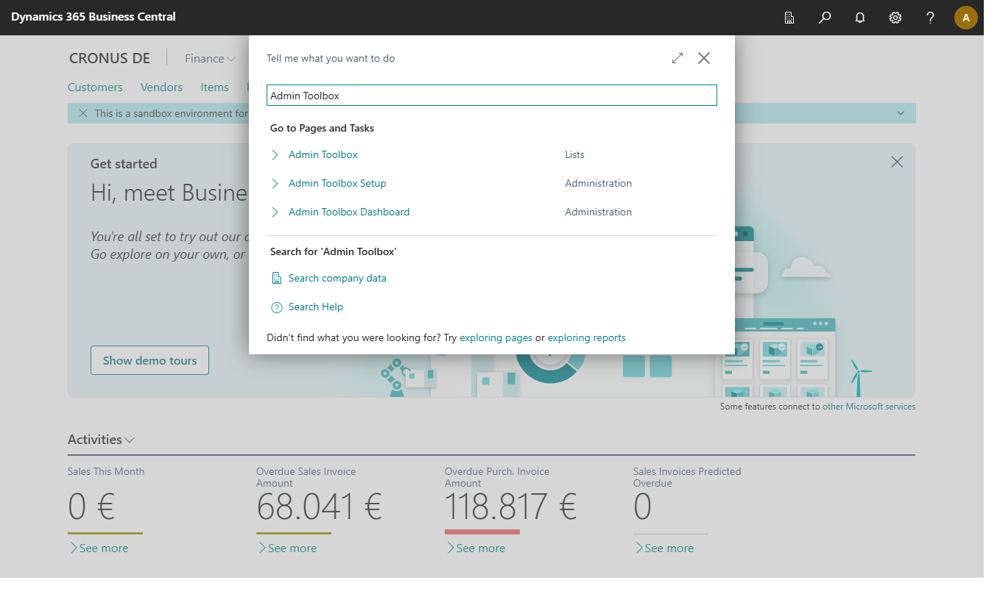

### Building from source

1. Clone the repository: `git clone https://github.com/wbrakowski/Admin-Toolbox-OnPrem.git`
2. Open `AdminTool.code-workspace` in Visual Studio Code. The workspace contains the repository root, the app in `app/` and the test app in `test/`.
3. Adjust `platform`, `application` and `runtime` in `app/app.json` if you target another Business Central version.
4. Copy the PowerShell Runner assembly of your Business Central version to `app/.netpackages`. Keep exactly one file in that folder.

   The assembly is part of every Business Central installation and is the safest source, because its assembly version equals the major version of the service tier. You find it in the service tier folder, for example `C:\Program Files\Microsoft Dynamics NAV\280\Service\Add-ins\PowerShellRunner\Microsoft.Dynamics.Nav.PowerShellRunner.dll` for version 28.

   For convenience the folder `powershellrunners` contains copies of the files:

   | Business Central version | File in `powershellrunners` |
   |---|---|
   | 15 to 20 | `<version>_Microsoft.Dynamics.Nav.PowerShellRunner.dll` |
   | 21 to 28 | No copy of its own. Use the file of your installation |
   | 29 | `29_Microsoft.Dynamics.Nav.PowerShellRunner.dll` |

   In a test with the containers of version 28 and 29, apps that were compiled against the files of version 15, 17, 19, 20 and 29 all bound to the assembly of the service tier. A single file such as version 20 is therefore likely to work for the newer versions that run on .NET. This was only verified for versions 28 and 29. Older service tiers that run on the .NET Framework bind strictly by assembly version, so use the file of the same major version there.

5. Download the symbols, compile and publish the app.

The setting `al.assemblyProbingPaths` in `app/.vscode/settings.json` points to `./.netpackages`.

## Getting started

The Admin Toolbox page combines all functions in one place. The ribbon groups the actions by task: **Tables**, **Deletion** and **Audit & Backup**. The page contains the following areas:

- **Welcome**: short instructions and a link to this documentation. The area can be hidden in the [Setup](#setup).
- **Tables**: the list of all tables with their record counts. Record deletion and the Table Editor start from here.
- **License Information**: license details and import (OnPrem only).
- **Information**: links to system tables.
- **Table Backups** (FactBox): the backups of the selected table.

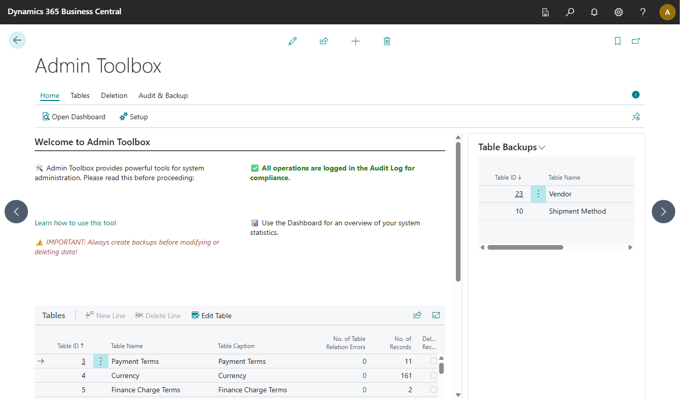

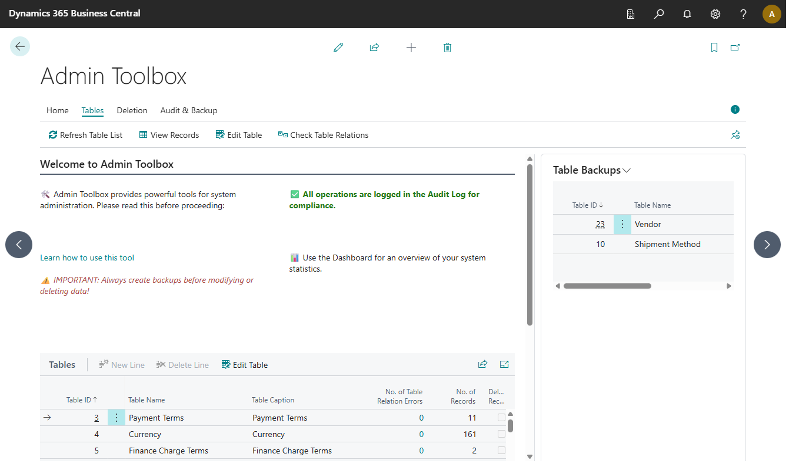

When you open the toolbox for the first time, a guided tour describes the available functions. To start the tour again, select the page title.

## Dashboard

The dashboard gives a quick overview. Open it with **Open Dashboard** on the toolbox page.

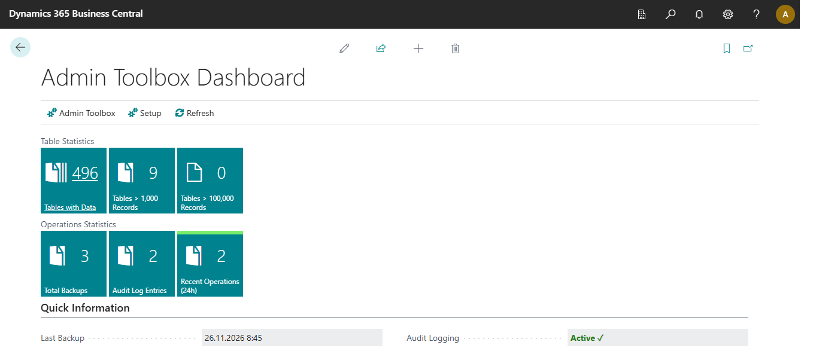

| Tile | Description |
|---|---|
| Tables with Data | Number of tables with at least one record in the current company |
| Tables > 1,000 Records | Number of tables with more than 1,000 records |
| Tables > 100,000 Records | Number of tables with more than 100,000 records |
| Total Backups | Number of table backups |
| Audit Log Entries | Number of audit log entries |
| Recent Operations (24h) | Number of operations in the last 24 hours |

**Last Backup** shows when the latest backup was created, and **Audit Logging** shows whether audit log entries exist. Selecting a tile opens the matching list. **Refresh** recalculates all values.

## Setup

Open the setup with **Setup** on the toolbox page. The settings apply to all users.

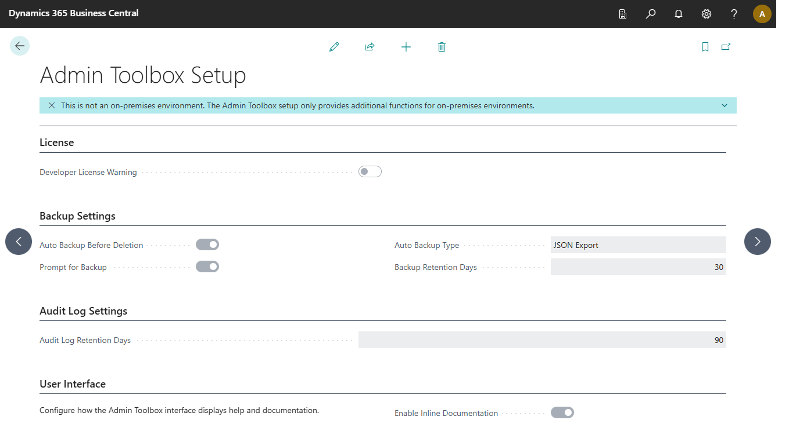

| Setting | Default | Description |
|---|---|---|
| Auto Backup Before Deletion | Yes | Create a backup of each table before its records are deleted |
| Prompt for Backup | Yes | Ask for confirmation before the backups are created. If disabled, the backups are created without a prompt |
| Auto Backup Type | JSON Export | Backup type that is used for automatic backups |
| Backup Retention Days | 30 | Age in days after which backups can be deleted with **Delete Old Backups** |
| Audit Log Retention Days | 90 | Age in days after which entries can be deleted with **Delete Old Entries**. Set 0 to keep all entries |
| Developer License Warning | No | Show a message on company open when a developer license is active (OnPrem only) |
| Enable Inline Documentation | Yes | Show the welcome text and the help texts of the guided tour |

Recommendations for production systems: keep **Auto Backup Before Deletion** enabled, keep **Prompt for Backup** enabled so that users are aware of the backups, and set the retention days according to your compliance requirements.

## Record deletion

The record deletion removes all records from the marked tables. Typical uses are cleaning a company of transactional data before go-live or preparing a company for demos, training or tests. The function is based on the [Record Deletion Tool](https://navinsights.net/2020/04/02/record-deletion-tool/).

The **Tables** list shows all tables of the database except system tables and the tables of the Admin Toolbox itself. The columns are Table ID, Table Name, Table Caption, **No. of Table Relation Errors**, **No. of Records** and **Delete Records**. Records are only deleted from tables for which **Delete Records** is selected.

### Procedure

1. **Refresh Table List** (group Tables). Adds tables that are not yet in the list. Run it again after you installed new apps.
2. **Suggest Records** (group Deletion). Select what you want to mark:

   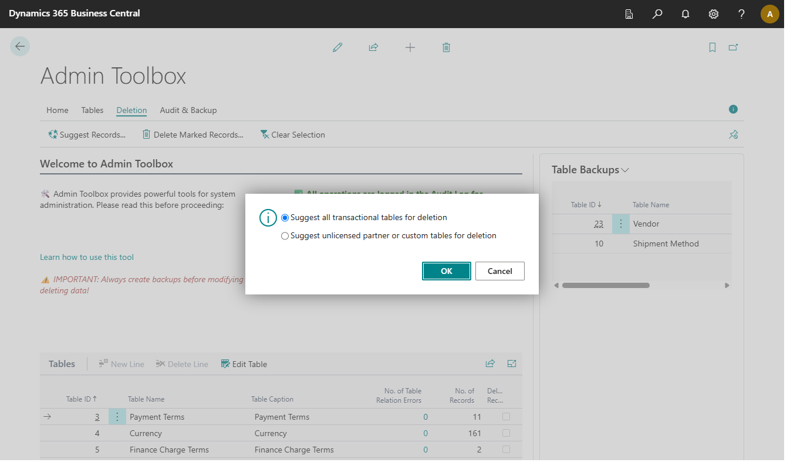

   - *Suggest all transactional tables for deletion* marks the tables that usually contain transactional data.
   - *Suggest unlicensed partner or custom tables for deletion* marks tables from partner or custom objects that are not covered by the license. Use this option with the customer license. If a developer license is imported, the tool offers to import another license first. To delete the marked records afterwards, a developer license is required.

   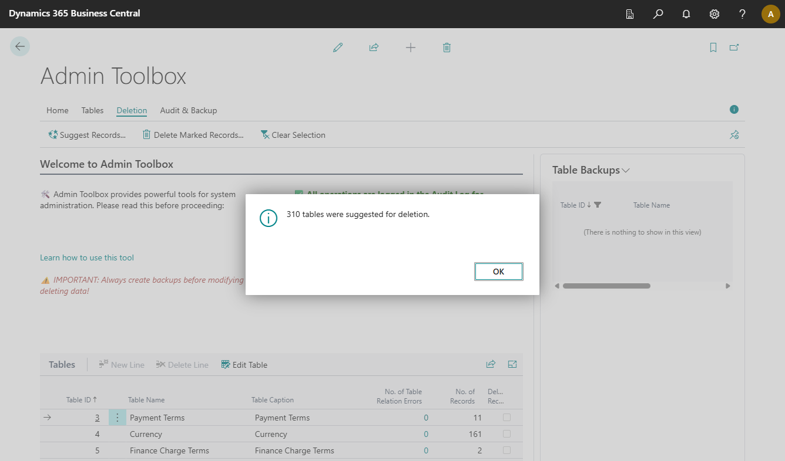

3. Review the marked tables. Add or remove tables manually. **View Records** opens the selected table in a separate window. A filter on **No. of Records** shows the tables that still contain data.

   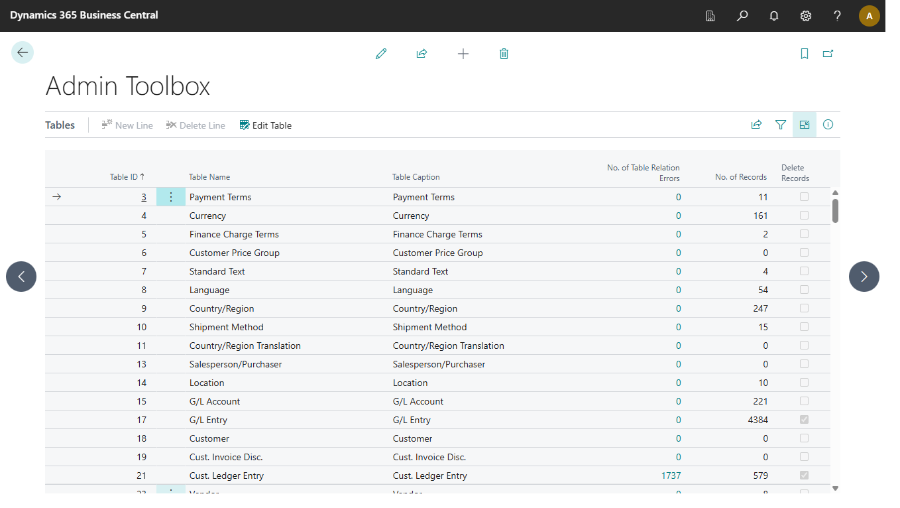

4. Optional: [check the table relations](#table-relation-check).
5. **Delete Marked Records** (group Deletion). Choose whether the table triggers are executed:

   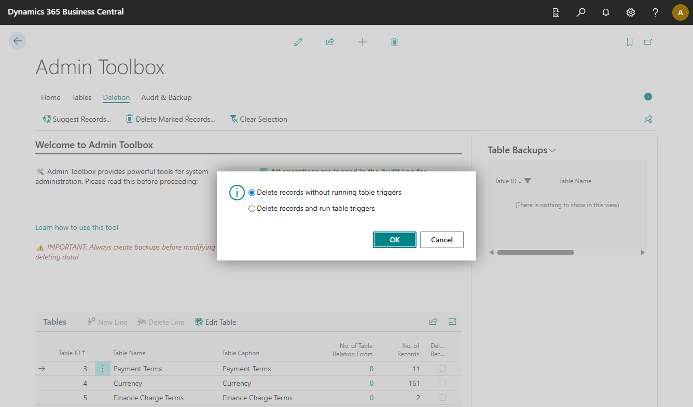

   - *Delete records without running table triggers* is faster and is the default.
   - *Delete records and run table triggers* runs the delete triggers of the tables.

   The toolbox then shows the number of marked tables and asks for confirmation.

   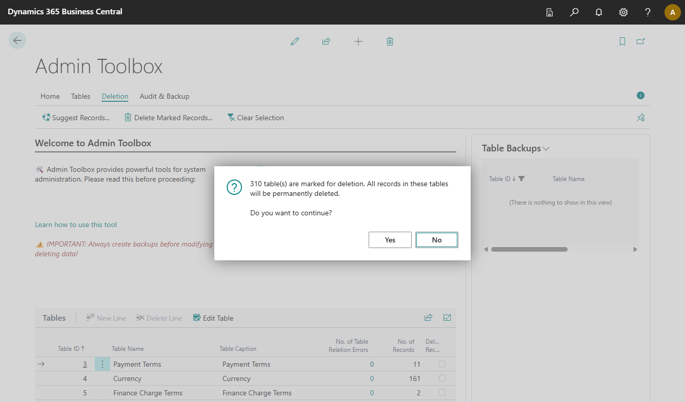

6. If **Auto Backup Before Deletion** is enabled in the setup, the toolbox offers to create a backup of each table. Tables with field types that cannot be backed up are listed in one additional question. The backups are committed before the first record is deleted, so they remain available if the deletion fails.
7. **Clear Selection** clears **Delete Records** for all tables.

Each deleted table is logged in the [audit log](#audit-log) as a Delete operation with the number of deleted records.

The tables of the Admin Toolbox and system tables are protected. If one of them is marked, the deletion stops with an error before any record is changed.

### Table relation check

**Check Table Relations** (group Tables) checks for every listed table whether the records refer to related records that exist. After a confirmation the toolbox shows the progress with table, name and percentage.

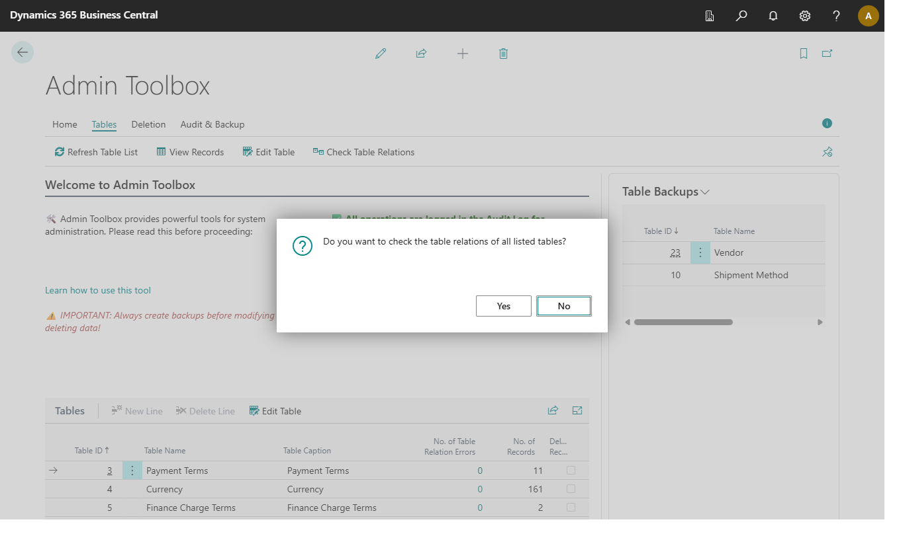

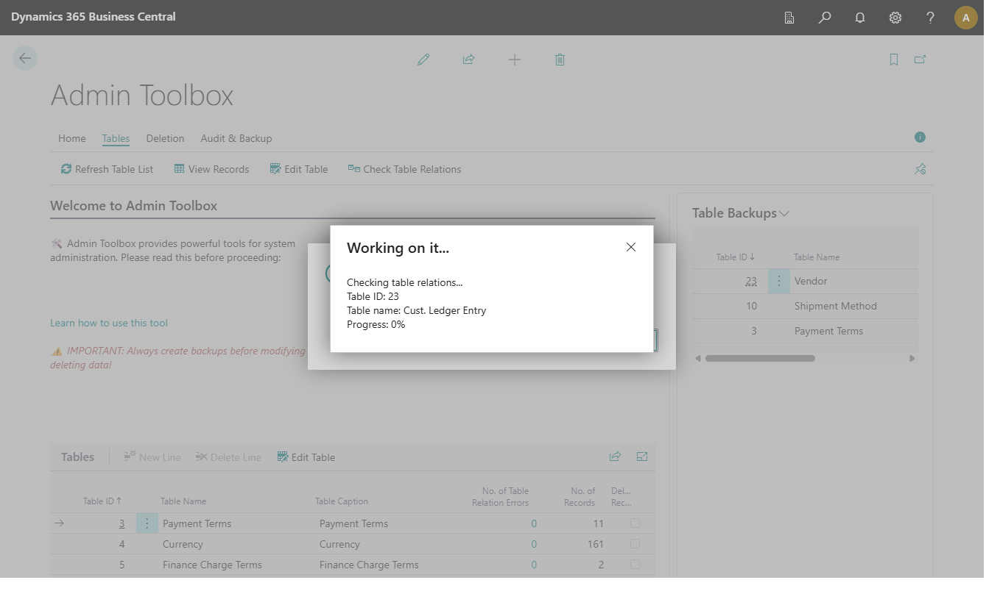

The check uses the table relations that are defined on the fields of the tables. It has the following properties:

- Only simple relations from one field to one field of another table are checked. Relations with several fields and conditional relations are not checked.
- Empty values, zero and empty GUIDs are ignored.
- Relations to system tables and to tables that cannot be opened, for example tables of external connections, are skipped.
- The result is stored per table and shown in the column **No. of Table Relation Errors**.

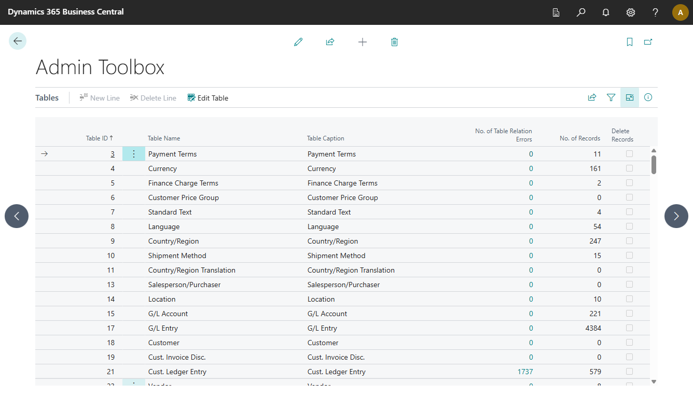

Select the number to open the errors of a table. Each error names the record, the value and the field and table in which the value was not found.

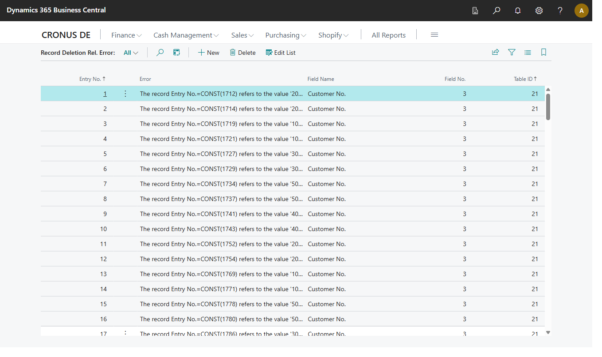

The check is a helpful indicator, not a complete integrity check. On large databases it can take some time.

## Table Editor

The Table Editor modifies, renames, creates or deletes records of any table. Open it with **Edit Table** for the selected table in the list. Special thanks to [Yuri Mishin](https://www.linkedin.com/in/yuri-mishin-2a08a71b4/), who developed the Table Editor.

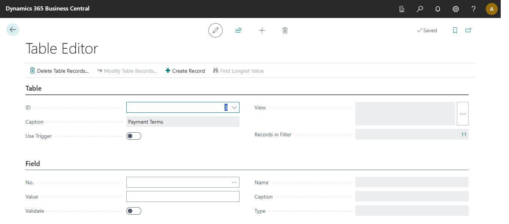

| Field | Description |
|---|---|
| ID, Caption | The table to edit |
| Use Trigger | Run the triggers of the table when records are modified or deleted |
| View | Filter that selects the records. **Records in Filter** shows how many records are selected |
| No. | Field to change. Name, Caption and Type of the field are shown |
| Value | New value |
| Validate | Run the OnValidate trigger of the field |

| Action | Description |
|---|---|
| Modify Table Records | Sets the value in the selected records. If the field is part of the primary key, the action renames the records instead |
| Delete Table Records | Deletes the selected records |
| Create Record | Creates a record. Every field of the primary key must be filtered to a single value in **View** |
| Find Longest Value | Shows the longest value of the selected field |

Before any change the Table Editor asks for confirmation. When you delete records, it can create a backup first if that is set up in the [Setup](#setup).

Every operation is logged in the audit log. Modify and rename operations are logged as Bulk Modify with old and new values of each changed field, deletions as Bulk Delete. Tables of the Admin Toolbox and system tables cannot be changed. The Table Editor requires the SUPER permission set.

The Table Editor changes data directly. Use filters carefully, enable **Validate** when business rules must be respected, and check the audit log afterwards.

## Table backups

Open the backups with **Manage Backups** in the ribbon group Audit & Backup. The FactBox on the toolbox page shows the backups of the selected table.

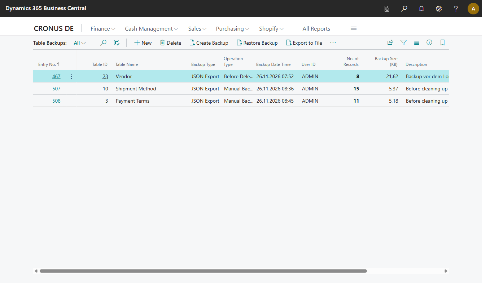

### Backup types

All backup types store the table data as JSON in the backup record.

| Type | Use |
|---|---|
| JSON Export | Default. Portable, readable, can be exported to a file |
| Snapshot | Reserves a snapshot table ID in addition to the JSON data |
| Full Backup | Same storage as JSON Export, intended for complete backups |

The operation type shows why a backup was created: Manual Backup, Before Deletion, Before Modification or Scheduled Backup.

### Create a backup

1. Select **Create Backup**.
2. Select the table, the backup type and enter an optional description.
3. To back up only some records, enable **Use Filter** and set the filter with the assist edit button of **Filter View**. Use Filter without a filter is rejected.
4. Confirm with **OK**.

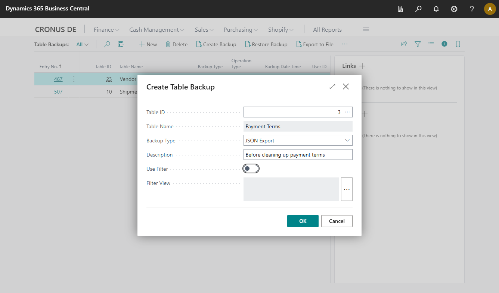

The following field types are backed up: integer, big integer, decimal, boolean, date, time, date and time, GUID, option and enum, text, code, duration and date formula. Fields of other types, for example BLOB, Media, MediaSet and RecordID, are skipped and cannot be restored. If a table contains such fields, the toolbox asks for confirmation before it creates the backup.

Values are stored independent of the language and region settings, so that backups can be restored in a different environment.

### Restore a backup

1. Select the backup and choose **Restore Backup**.
2. Confirm the question.

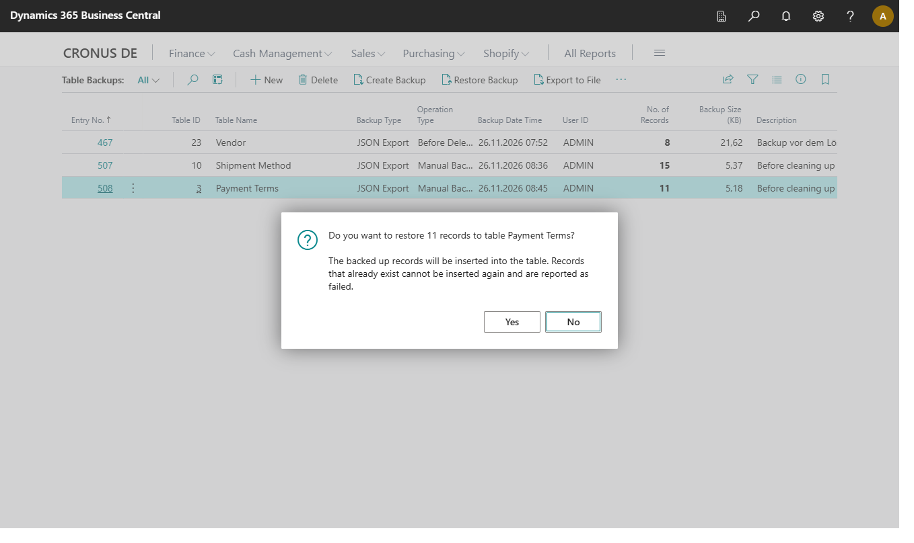

The records are inserted one by one. Existing records are not changed. Records that already exist or that cannot be inserted are counted as failed, and the restore continues. The result message shows how many records were restored. A value in the backup that cannot be converted stops the affected record and names the value and the field. If no record can be inserted, the restore ends with an error. The backup records the restore date.

### Export, import and cleanup

- **Export to File** saves the JSON data of a backup in a file.
- **Import from File** creates a backup from a JSON file for a selected table.
- **View Backup Data** shows the first 1,000 characters of the data.
- **Delete Old Backups** deletes the backups that are older than **Backup Retention Days**.

## Audit log

The audit log records the operations of the Admin Toolbox. Open it with **View Audit Log** in the ribbon group Audit & Backup.

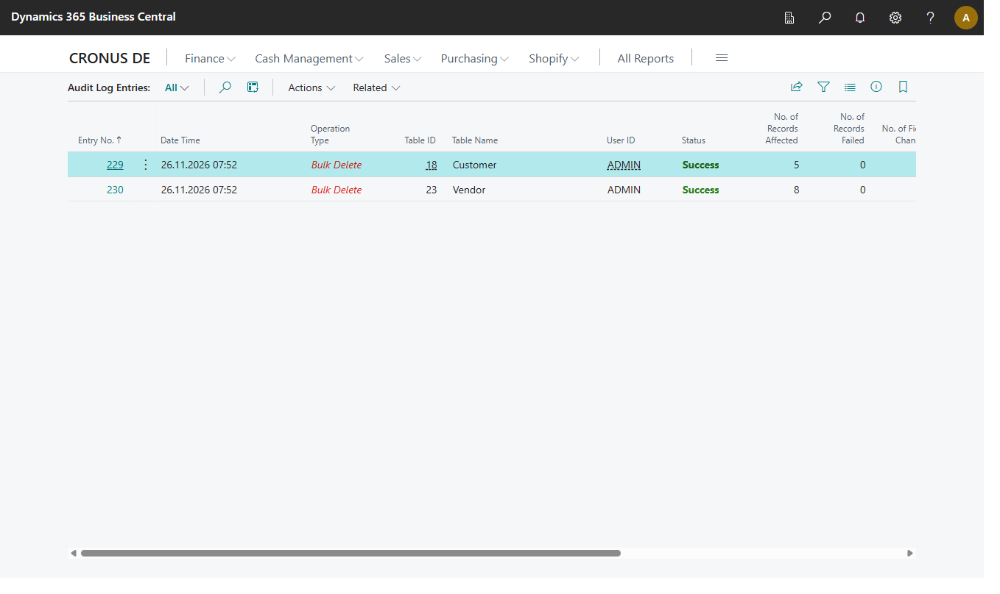

Each entry contains the date and time, the user, the operation type (Insert, Modify, Delete, Bulk Delete, Bulk Modify), the table, the status, the number of affected and failed records, the number of changed fields, the duration, a description and the originating function. If a backup was created before the operation, the entry links to it.

| Action | Description |
|---|---|
| View Field Changes | Shows old and new values of the changed fields. The FactBox shows them for the selected entry |
| View Related Backup | Opens the backup that was created before the operation |
| Export to Excel | Exports the entries |
| Delete Old Entries | Deletes entries that are older than **Audit Log Retention Days** |
| Filter by Table, Filter by User, Clear Filters | Filter functions |

Deleted audit log entries cannot be restored. Export them to Excel first if they are subject to retention requirements.

## Information tables

The **Information** area opens frequently needed system tables in a new browser tab. Select the title **Information** to expand the area.

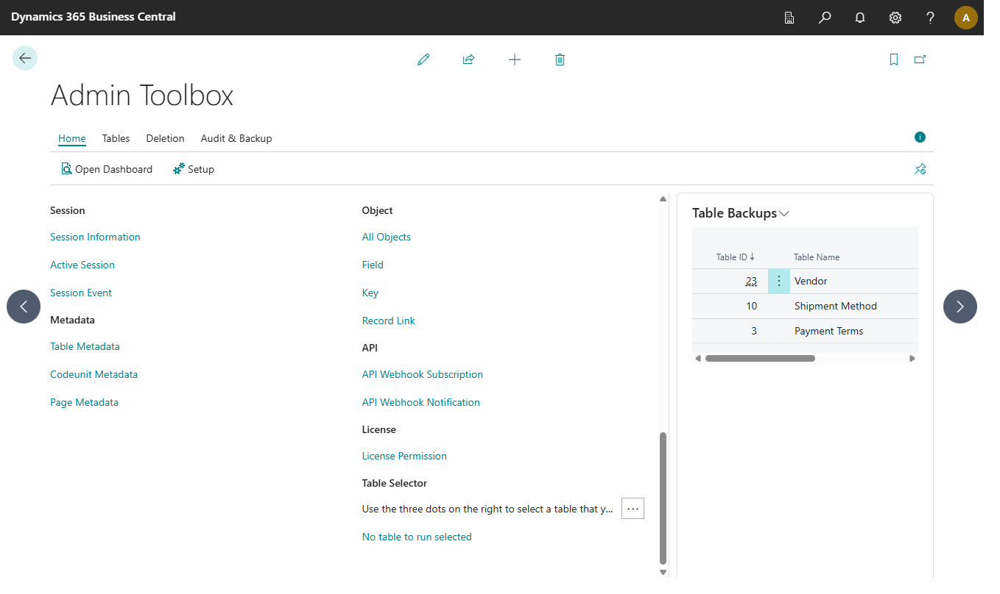

| Group | Tables |
|---|---|
| Session | Session, Active Session, Session Event |
| Metadata | Table Metadata, Codeunit Metadata, Page Metadata |
| Object | All Objects, Field, Key, Record Link |
| API | API Webhook Subscription, API Webhook Notification |
| License | License Permission |

With the **Table Selector** you can open any other table by its number.

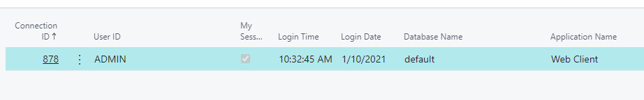

## License management

The functions in this section are available in OnPrem environments only.

### License information and developer license

The **License Information** area shows the details of the active license. A separate field shows whether the license is a developer license.

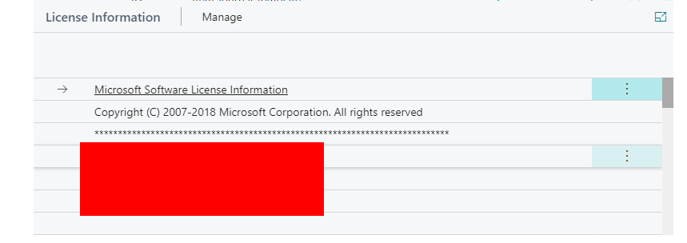

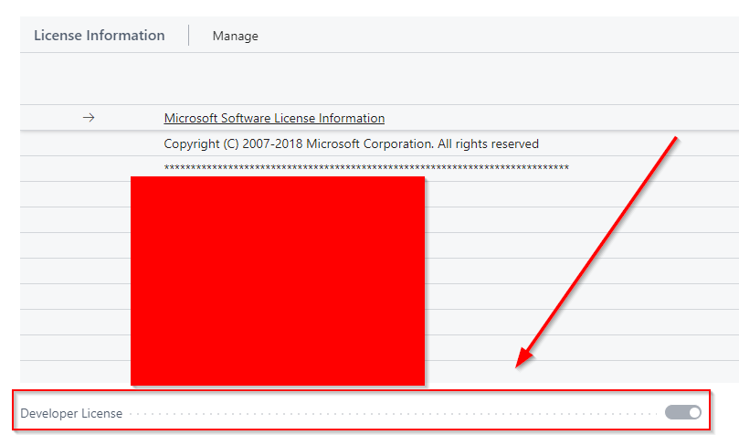

### Import a license

1. Select **Import License** in the License Information area.

   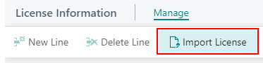

2. Select the license file (`.flf`).

   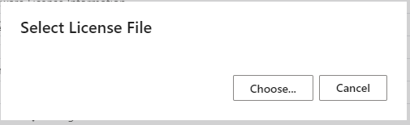

The license is imported and the service instance is restarted. All users are disconnected for a short time, so import licenses outside of working hours. The import requires the PowerShell Runner assembly and the permission to restart the service.

### License reports

- **Export Used and Unused Objects in License** lists license objects with their usage. Filter by object type, by ID range, and show only free objects if required.
- **Export Unlicensed Objects** lists objects that are not covered by the license. Use it before you switch from a developer license to a customer license.

### Developer license warning

When **Developer License Warning** is enabled in the setup, users with the SUPER permission set receive a message on company open if a developer license is active.

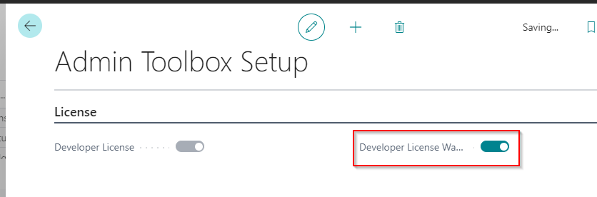

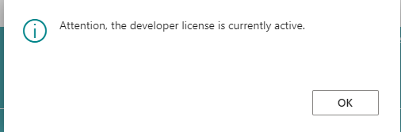

### Suggestion of unlicensed tables

When you suggest unlicensed tables for deletion with a developer license active, the toolbox offers to import a customer license first.

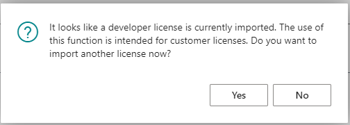

After the suggestion, the deletion of the marked tables requires the developer license again.

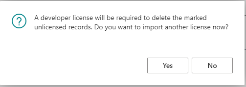

## Publishing apps

In OnPrem environments the toolbox can publish and install apps through the External Deployer. This requires the deployer to be installed on the server. The action **Publish & Install App** is available in the Apps group.

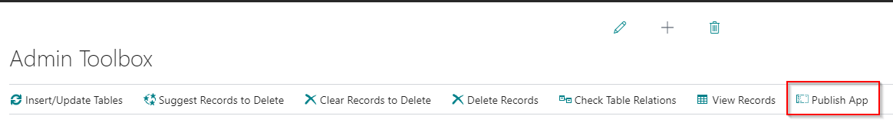

The dialog offers two options:

- *Learn how to install the external deployer* opens the installation instructions.
- *Continue publishing (opens a new browser tab)* opens the standard upload page. Use it only after the External Deployer is installed.

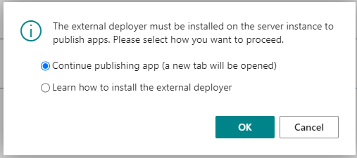

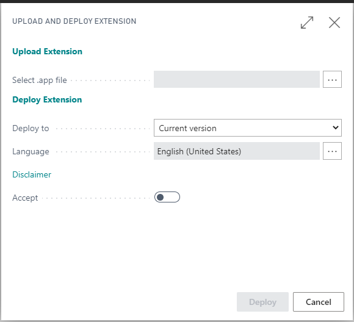

### Install the External Deployer

The External Deployer is an unofficial tool that simulates the extension upload of Business Central online for OnPrem installations. It is provided without official Microsoft support and can require updates for new versions. The instructions are based on [the blog post by Waldo](https://www.waldo.be/2020/06/15/deploying-from-devops-the-right-way-enabling-external-deployment-in-onprem-business-central-environments/). Run the following steps on the server that hosts the service instance, in PowerShell as administrator:

```powershell
Install-Module ALOps.ExternalDeployer -Force
Import-Module ALOps.ExternalDeployer
Install-ALOpsExternalDeployer
New-ALOpsExternalDeployer -ServerInstance <ServerInstance>
```

The last command configures the service instance and restarts it. To verify the installation, select **Publish & Install App**, choose *Continue publishing* and check that the upload page opens.

If the upload fails, check that the service restarted successfully and review the Windows event log. If the error "External Deployer not configured" appears, run the last command again with the correct server instance name.

## Permissions and security

- The toolbox pages and the Table Editor can only be used by users with the SUPER permission set. Other users receive an error when they open the page.
- The app contains the permission set **Admin Toolbox**.
- The tables of the Admin Toolbox itself and system tables cannot be deleted or changed by the toolbox.
- Operations that change data are logged in the audit log, and deletions can be preceded by a backup.

## Languages

The app is available in English, German and Spanish. The Spanish translation was created with machine translation and needs review. Corrections are welcome as pull requests.

## Development and testing

The repository contains two AL projects:

| Folder | Content | Object IDs |
|---|---|---|
| `app/` | The Admin Toolbox | 51000 to 51099 |
| `test/` | Automated tests (AL Test Toolkit, depends on `Library Assert`) | 51100 to 51149 |

The AL objects use the namespace `AdminToolbox`. All OnPrem specific code is enclosed in `#if OnPrem` directives, and the app is compiled with the preprocessor symbol `OnPrem`.

The tests cover the backup and restore logic, record deletion with the relation check, the audit log, the Table Editor logic, the setup and the main pages. To run them:

1. Publish `app/` first and `test/` second. Unpublish the test app before you publish a new build of the app.
2. Run all tests with the AL Test Tool or `AL: Run All Tests`.

The tests expect an English session language and must never be run against production data.

The conventions for contributors and coding agents are described in [.github/copilot-instructions.md](.github/copilot-instructions.md).

## Contributing

Contributions are welcome.

- Report errors and requests as [GitHub issues](https://github.com/wbrakowski/Admin-Toolbox-OnPrem/issues). Include the Business Central version, the app version, the steps to reproduce and error messages or screenshots.
- For code changes, create a branch, follow the existing code style, add or update tests in `test/` and make sure that all tests pass. Describe the change in the pull request.
- Corrections of translations can be submitted as changed `.xlf` files.

## Credits

The Admin Toolbox combines contributions from the Business Central community:

- **Olof Simren**: original Record Deletion Tool for Microsoft Dynamics NAV
- **Yuri Mishin**: Table Editor and developer license warning
- **Waldo (Eric Wauters)**: license information, system information tables and External Deployer
- **Neil Roberts**: license import with PowerShell
- **Roberto Stefanetti**: used and unused objects
- **Waldemar Brakowski**: integration, record deletion tool, backup system, audit log, dashboard and maintenance

## License

The project is released under the MIT License. See the [LICENSE](LICENSE) file.

Repository: [https://github.com/wbrakowski/Admin-Toolbox-OnPrem](https://github.com/wbrakowski/Admin-Toolbox-OnPrem)
